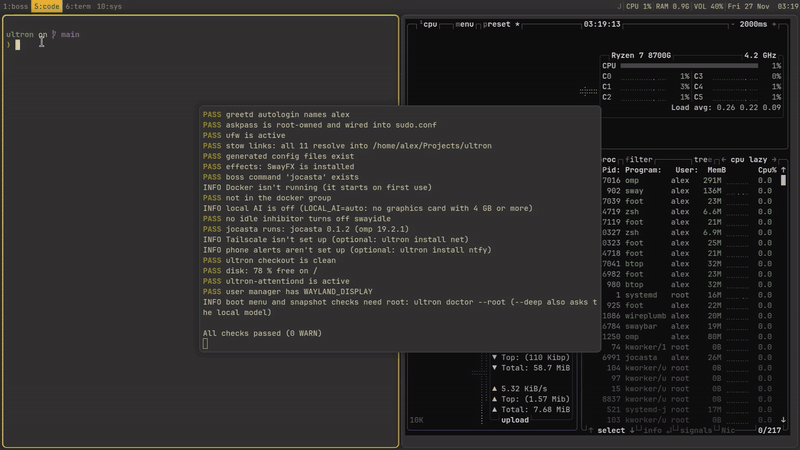
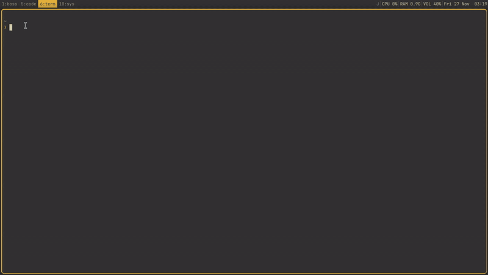
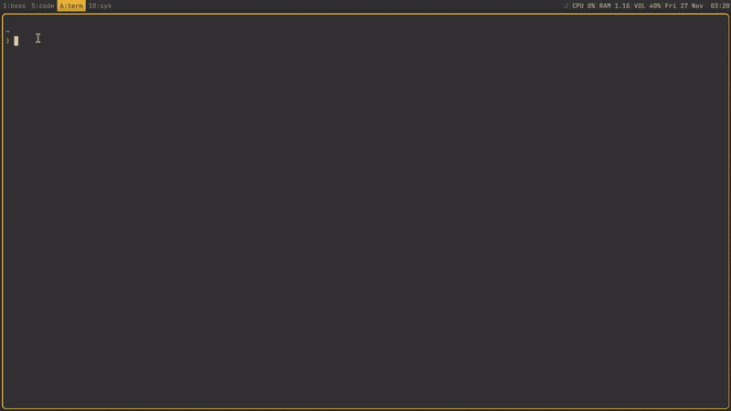
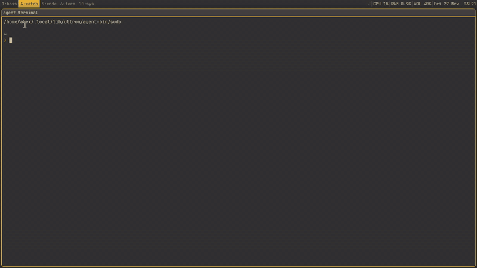
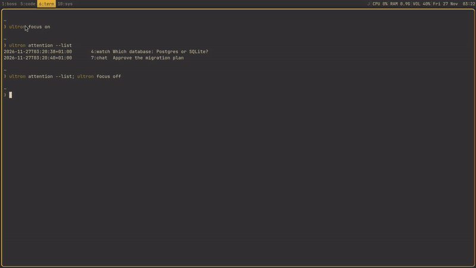
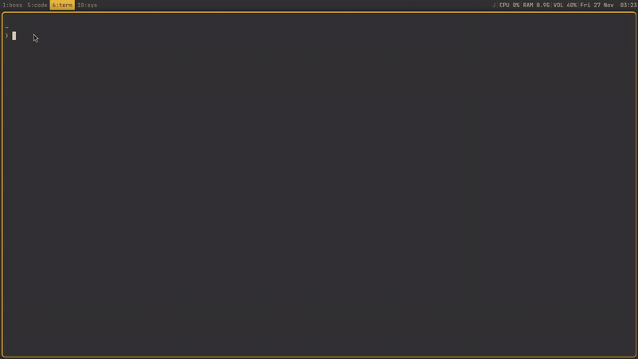

# ultron

**An Arch Linux desktop built for working with coding agents: install it, sign your agent in, and work.**

Recorded in the test VM (`vm/ultron-vm`). [Full-quality video](docs/media/desktop-themes.mp4).

## Why

Coding agents now run for minutes or hours, several at once, and each one wants to show you something or ask you something. A normal desktop treats them as one more terminal: their windows land wherever you are, their questions get lost, and every `sudo` is a leap of faith.

ultron gives agents a place on the desktop and rules to follow. They show you diffs, pages and terminals on their own workspaces without pulling you away; when one is truly blocked on you, it waits in a queue and you are taken there only once you stop typing. Root always goes through you. You don't need to know Arch, pacman or sway to use it; if you do, everything is a plain file you can change.

## Features

- **Agent-first workspaces.** The boss agent lives on workspace 1. Agents open review pages, diffs and files on 2, local web pages on 3 and long-running terminals on 4, as tabs. Showing never moves you: the bar marks the workspace (`new 2`) and you look when you want.
- **Attention queue.** An agent blocked on you raises a request (`ultron attention --raise`). Requests queue oldest first; you are taken to one only after you stop typing, never in focus mode (Super+M), and when you are away the question goes to your phone. Super+A walks the queue.
- **Jocasta as the boss.** [Jocasta](https://github.com/zhivko-kocev/jocasta) is the default boss: it runs many [omp](https://github.com/can1357/oh-my-pi) sessions as threads, each on its own branch and worktree, with review pages for finished work. omp, Claude Code, Codex, Gemini CLI and opencode can be the boss instead (one command away), and any other CLI can be added.
- **SwayFX effects.** Rounded corners, shadows and window animations by default, with stock sway as the automatic fallback when an update needs SwayFX rebuilt ([why](docs/adr/0002-swayfx-by-default-with-stock-sway-fallback.md)).
- **Safe enough to let agents work.** Root needs your password in a popup that shows the exact command, every time. Docker is rootless. The disk is encrypted. Every package change has a snapshot you can boot. [What this protects and what it doesn't](docs/security.md).
- **Themes, fonts and backgrounds.** Six themes (or your own), any monospaced font and your own background image, switched from the menu (Style). A theme recolours sway, the bar, terminals, the launcher, notifications, the lock screen, GTK apps and Jocasta.
- **Per-project tools without touching the repo.** A project's tools, environment and tasks can live in `~/.config/mise/config.<repo>.toml`; your shell and Jocasta's threads load it, in every worktree ([how](docs/customize.md#project-tools-without-touching-the-repo)).
- **Local AI when your hardware can take it.** ollama is set up by itself when a graphics card with about 4 GB of memory or more is found; `ask` uses it from any terminal.
- **Light.** sway, foot, fuzzel, mako and a bash status bar: about 600 MB of RAM at an idle desktop before any agent starts ([measured](docs/baseline.md)). No daemons you didn't ask for.
- **Yours.** One menu for everything (Super+Alt+Space), and a `~/.config/ultron/` folder where your settings, keys, packages and overrides live without forking anything.

## See it

| | |
|---|---|
| **Showing never moves you.** From workspace 6 an agent opens a review terminal and a page; the bar says `new 2 3`, and Super+A visits them when you choose. [video](docs/media/show-no-move.mp4) |  |
| **The attention queue.** Two agents are blocked on you in focus mode; `ultron attention --list` shows them oldest first and Super+A walks them. [video](docs/media/attention-queue.mp4) |  |
| **Root goes through you.** An agent's `sudo` opens a popup that names the exact command; nothing runs as root without your password. [video](docs/media/sudo-popup.mp4) |  |
| **Jocasta is the boss.** The boss pane beside Jocasta's `today` dock (what needs you, what is underway, briefs), on a fresh install before `/login`. [video](docs/media/jocasta-boss.mp4) |  |
| **Every key, searchable,** plus the emoji and colour pickers (Super+K, Super+Ctrl+E, Capture ▸ Colour). [video](docs/media/keys-pickers.mp4) |  |

## Install

You need a PC or laptop (x86-64, UEFI) whose disk can be **erased**, a USB stick, and a network connection (cable or Wi-Fi). Intel and AMD graphics work out of the box; NVIDIA runs on the open driver and is untested.

1. Download `ultron-<version>-x86_64.iso` (and its `.sha256`) from the [latest release](https://github.com/zhivko-kocev/ultron/releases/latest) and write it to the stick with any image writer (balenaEtcher, Rufus in DD mode, or `dd`).
2. Check the firmware settings ([docs/bios.md](docs/bios.md)) and boot the stick in **UEFI** mode. The installer starts by itself. Without a cable it lists the Wi-Fi networks: pick yours and type its password.
3. It asks for a user name, host name, time zone, keyboard layout, an optional dotfiles repo, which disk to erase (you type `wipe`), and the passwords. Then it installs Arch.
4. Remove the stick, reboot, and type the disk password. The install continues by itself (it asks for your password once), then reboots into the desktop, which shows a short welcome.

If the install stops on the first boot, it says which step failed and waits for Enter before the desktop starts; fix that and run `ultron install --first-boot` (the next login on tty1 also tries again).

**From a stock Arch ISO** ([archlinux.org/download](https://archlinux.org/download/)), boot it in UEFI mode, join Wi-Fi with `iwctl` if you need to, and run:

    bash <(curl -fsSL https://raw.githubusercontent.com/zhivko-kocev/ultron/main/bootstrap.sh)

The rest is the same as steps 3 and 4.

Coming from another Linux install on the same disk? [docs/migrate.md](docs/migrate.md) carries your home folder across.

## Using it

The first thing to do in a fresh boss window is `/login` (omp's sign-in).

| Key | |
|---|---|
| Super+Alt+Space | the menu: install and remove things, setup, style, toggles, capture, update, power |
| Super+K | every key, searchable |
| Super+Space / Super+Return | apps / terminal |
| Super+B | the boss agent |
| Super+A | the oldest agent that needs you, else the newest window agents showed you that you haven't looked at; Super+Backspace goes back to your last workspace |
| Super+M | focus mode: agents can't move you, notifications wait |
| Super+Shift+S | screenshot a region and hand it to the boss |

Super+K lists every key, read from the sway config, so it is always current; the agent keys are explained in [docs/keys.md](docs/keys.md). The words ultron uses (workspace, boss, thread, show, attention request…) are in [GLOSSARY.md](GLOSSARY.md).

| Workspace | What lives there |
|---|---|
| 1 boss | your boss agent, started at login |
| 2 review | review pages, diffs, files and test runs agents show you |
| 3 web | local pages agents open, in a separate preview browser |
| 4 watch | long-running terminals agents open |
| 5 code · 6 term · 7 chat · 8 | yours |
| 9 browse | your browser |
| 10 sys | system monitor, updates |

From a terminal, `ultron` does everything the menu does:

    ultron update                 # ultron itself, packages, tools, agents; then a health check
    ultron doctor                 # is everything all right?
    ultron pkg install            # search and install packages
    ultron dev add python         # languages and runtimes
    ultron agent add claude       # another agent; `ultron agent boss claude` makes it the boss
    ultron theme                  # switch theme
    ultron setup wifi             # also: bluetooth audio display keyboard browser git dotfiles …

Optional extras: `ultron install net` (Tailscale remote access), `ultron install ntfy` (phone alerts).

**Undoing a bad update:** at the boot menu open Snapshots, pick one from before the update and boot it. If it's good, run `sudo limine-snapper-restore` there and reboot.

**For agents:** they learn the machine from `ultron guide` (rules) and `ultron info --json` (facts), show things with `ultron show …`, and call you with `ultron attention --raise "…"`. How to add agents and wire their notifications: [docs/agents.md](docs/agents.md).

## Customize

Settings (`ultron conf`), themes, fonts, backgrounds, effects, your own keys and monitor layout, extra packages, per-app overrides, hooks, per-project tools and your dotfiles repo: [docs/customize.md](docs/customize.md). You never need to fork ultron for any of it.

Without a dotfiles repo you get a starter zsh with starship, zoxide, eza, bat, lazygit and lazydocker. The menu also has stay awake, night light, screen recording, and colour and emoji pickers.

## Develop

ultron is bash: a `ultron` command, one file per command and per install step, and an installer for the Arch live ISO. Everything is tested in a QEMU VM, never on the machine you work on.

    vm/ultron-vm create        # download and verify the Arch ISO, make a 40G disk
    vm/ultron-vm run --iso     # boot the installer, then run the bootstrap line
    vm/ultron-vm run           # boot the installed system (--nogl if graphics misbehave)
    bash tests/run             # the self-checks (no root, no desktop)

How to propose a change, the full dev loop, the rules and how releases work: [CONTRIBUTING.md](CONTRIBUTING.md). Agents working on the repo read [AGENTS.md](AGENTS.md).

Under the hood: Arch Linux · LUKS2 + btrfs + snapper · Limine with bootable snapshots · greetd · SwayFX (stock sway as the fallback) · foot · fuzzel · mako · PipeWire · ufw · rootless Docker · mise · ollama · Tailscale and ntfy (optional).

| Folder | |
|---|---|
| `bootstrap.sh`, `install/`, `iso/` | the live-ISO installer and the ISO it ships on |
| `bin/ultron`, `lib/` | the `ultron` command and the install steps (bash) |
| `packages/` | package lists |
| `system/` | root-owned files, copied into `/` |
| `home/`, `templates/`, `themes/`, `skel/` | desktop config, themed templates, themes, starter shell |
| `agents/` | the agent registry |
| `tests/` | self-checks |
| `vm/` | test the whole install in a QEMU VM |
| `docs/` | the documentation below; `docs/adr/` records why the big choices were made |

## Docs

- [customize.md](docs/customize.md): settings, themes, keys, monitors, packages, hooks, dotfiles, per-project tools
- [keys.md](docs/keys.md): the agent keys
- [agents.md](docs/agents.md): adding agents, the boss, how agents show things and call you
- [jocasta.md](docs/jocasta.md): Jocasta on ultron
- [security.md](docs/security.md): what ultron protects and what it doesn't
- [bios.md](docs/bios.md): firmware settings before installing
- [migrate.md](docs/migrate.md): moving a home folder from another install
- [baseline.md](docs/baseline.md): measured memory and disk use
- [adr/](docs/adr/): decision records
- [GLOSSARY.md](GLOSSARY.md) · [CHANGELOG.md](CHANGELOG.md) · [CONTRIBUTING.md](CONTRIBUTING.md)

## License

[MIT](LICENSE).
